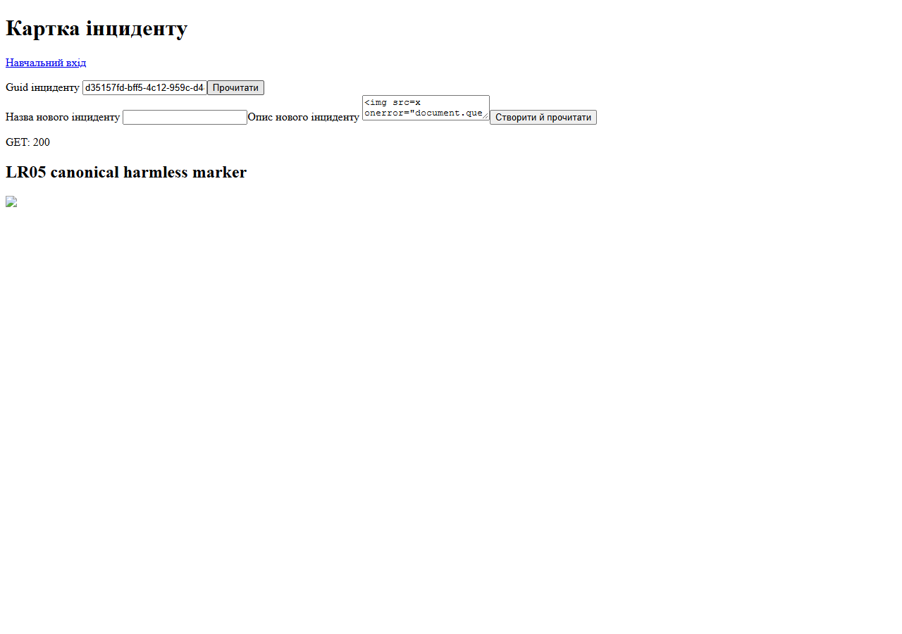
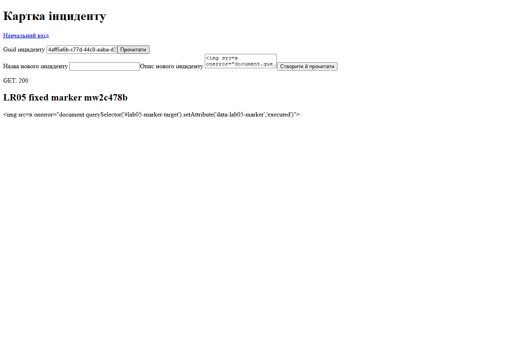
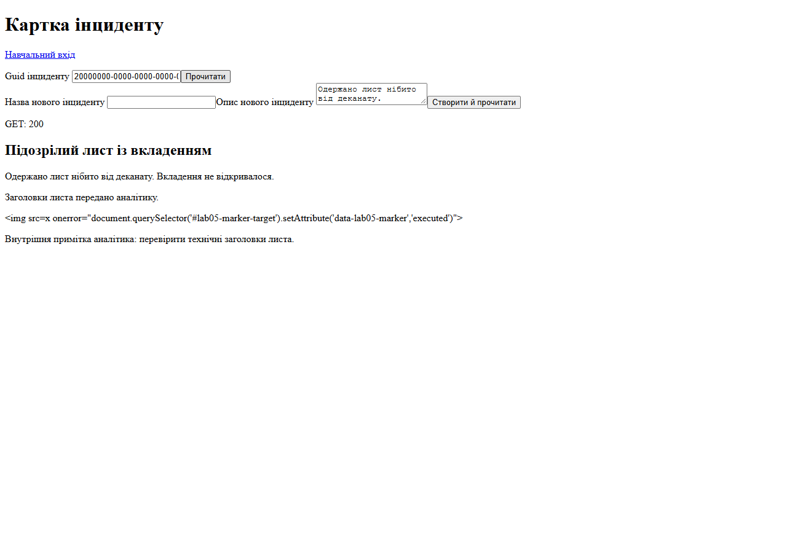

# Докази безпеки браузера — DEL-01

Автор: Торонченко Дмитро, КБ-41. Дата: 04.11.2026. Спільний сценарій 2-A.
Рівень: **«Добре»**, включно з усім достатнім рівнем. Перевірки виконано Codex
на локальному стенді; вони не видаються за самостійний ручний захист студентом.

## Стенд і стани

| Параметр | Фактичне значення |
|---|---|
| ОС / SDK / browser | Windows; .NET SDK 10.0.401; Chrome 156.0.8078.80 (headless, реальний DOM) |
| API/client | http://localhost:5080 |
| Probes | allowed http://localhost:4173; disallowed http://localhost:4174 |
| БД | PostgreSQL 18.4, secure-lab-postgres-1, loopback 127.0.0.1:54329 |
| Scaffold | lab-05-start-v1, усі 4 SHA-256 збігалися з виданим manifest |
| Base / entry_parent | 0416fb1378cec41bc08d67d34d814e0fc498d087, тег v0.4.0 |
| Гілка | lab/5-browser-xss |
| Vulnerable commit | 3f7f726d6b6b2de26172497ce2fa77beffe11a7d |
| Fixed commit / v0.5.0 / main | Очікують Git-дій студента; наразі не заявляються виконаними |
| Спосіб подання Git | Ще не обрано: погоджений приватний remote або перевірений bundle |

Vulnerable browser-lab.js відповідав виданому scaffold без safe fix/CSP.
До досліду коментаря у робоче дерево додано seed fixture …0005 з методички;
сам scaffold commit цього fixture не містить. Для replay другого поля потрібна
саме ця seed-зміна DbSeeder, збережена у fixed state; не слід приписувати її
наявність чистому vulnerable commit. Окремий seed commit був рекомендованим,
а не обов'язковим. API authorization не вимикалася.

## Фактична послідовність і suite

1. Tool restore та locked-mode restore успішні. Sandbox restore спочатку завершився
   без діагностики; повтор поза sandbox успішний. Локальний PostgreSQL був healthy.
2. Початкові 113 тестів пройдено. Звичайний flow і 5 типів тексту перевірено до PoC.
3. Додано лише seed-коментар, виконано build/reset; captured vulnerable XSS і БД.
4. Замінено два HTML sinks; retest того самого marker-запису без CSP успішний.
5. Пройдено CORS до policy, exact policy без credentials, потім фінальний cookie-profile.
6. Увімкнено CSP enforcement; inline script/style старого lr04-probe перенесено
   у власні JS/CSS без послаблення policy.
7. До фінального suite повторно виконано reset, тому після suite для браузера
   створено новий marker-запис. Обидва Guid і докази наведені нижче.
8. Фінальна збірка: 0 warnings / 0 errors. Фінальний suite: **124 passed,
   0 failed, 0 skipped**, завершено 04.11.2026 о 18:31:18 +02:00 (Київ).
   Це 113 успадкованих cases і 11 нових BrowserSecurityTests, включно з Production.
   Початкова помилка нового Production test host через відсутній connection string
   виправлена в налаштуванні тесту; невдалий запуск не зараховується як PASS.
9. Після suite репозиторний browser runner дав PASS для fixed, cors-fixed і csp;
   час запусків: близько 18:32 +02:00. Direct HTTP — обидва 200.

[Build](evidence/lr05/final-build.txt), [suite output](evidence/lr05/final-tests.txt),
[TRX counters і 11 нових cases](evidence/lr05/test-summary.json).

## Механізм сеансу

Cookie: `.AspNetCore.Identity.Application`; host/domain `localhost`; Path `/`;
HttpOnly `true`; SameSite `Lax`; Secure `false` у локальному Development HTTP.
Production-конфігурація встановлює SecurePolicy.Always. Значення cookie не збережено.
Доказ метаданих: [fixed.json](evidence/lr05/fixed.json), поле cookies.
Порти localhost утворюють різні origins, але один site; цей дослід не є
універсальною перевіркою cross-site поведінки SameSite.

## Гіпотеза, finding і REG-XSS-01

[Повна карта обох flows](source-to-sink.md). Alice контролює textarea Description;
protected POST зберігає текст у incidents.description; protected GET повертає
`description`. Браузерний load передавав його в innerHTML. Для comments аналогічна
першопричина — paragraph.innerHTML для comments[].text із incident_comments.text.
Збереження, JSON escaping і перевірка ownership не усувають HTML interpretation.

Актив: DOM і можливості браузерного сеансу глядача, зокрема Morgan/Analyst.
Вплив на стенді: тільки canonical marker встановив data-lab05-marker=executed
на прихованому #lab05-marker-target. Cookie/storage не читалися; зовнішніх hosts
не було. Класифікація: stored XSS зі client-side DOM sink. Reflected flow не створювався.

| Спостереження | До fix | Після fix | Доказ |
|---|---|---|---|
| БД Description/comment | Canonical string без змін | Ті самі IDs і string | db-before.json = db-after.json |
| API | description/comments[].text дорівнюють marker | Значення збережено | vulnerable.json, fixed-without-csp.json, fixed.json |
| DOM Description | childElementCount=1, img | childElementCount=0, textContent=marker | JSON DOM snapshots |
| Дія marker Alice/Morgan | executed | null, також без CSP | vulnerable.json → fixed-without-csp.json |
| Друге поле comments | img у p, executed | p містить лише текст; повторний render без дублювання | comment-alice/comment-morgan cases |
| Контроль Bob | 404, marker null | 404, marker null | description-bob cases |
| Апостроф/лапки, < >, Unicode | Звичайний текст проходить | Точний текст збережено | normal.json → fixed.json |
| HTML-like рядок | b став DOM-елементом | `<b>жирний</b> текст` лишився текстом | normal-3 cases |
| Максимальна довжина | 4000 символів прийнято | 4000 символів у API/DOM, без втрат | normal-4 cases |

Виправлення: єдиний `renderPlainText(element, text)` у browser-lab.js пише
textContent. Обидва виклики — Description і comment paragraph. Структуру p
створює createElement, контейнер очищує replaceChildren. Форматований HTML
контрактом заборонений; sanitizer/regex blacklist не додавалися.

**Repeatable REG-XSS-01:** запустити актуальний Development seed/API; виконати
login Alice; з файла tests/browser/lab05-marker.txt скопіювати canonical marker
у Description і створити запис через «Створити й прочитати». Очікуються 201/200,
незмінний marker у JSON, текстовий DOM без img та null у контрольного атрибута.
Оновити сторінку перед кожним вимірюванням. У незалежному сеансі Morgan читати
той самий Guid: 200 і null; у Bob: 404 і null. Відкрити seed incident …0001:
public comment …0005 має бути текстом, internal …0003 доступний лише Analyst.
Повторити load і позитивні значення з таблиці. Негативний контроль збережено
на unsafe rendering до fix; CSP тоді не діяла.

Автоматичне повторення: [tests/browser/README.md](../tests/browser/README.md),
`node tests/browser/lab05-regression.cjs fixed`. API і probes запускаються окремо.
Після reset Guid може змінитися; це явно зазначається у доказах.

`d35157fd-bff5-4c12-959c-d48172756629`: значення досліду до fix і retest без CSP; БД-пара before/after стосується
саме нього. `4aff5a6b-c77d-44c0-aaba-d3f8e29ab0b3`: новий запис після фінального reset/suite для enforcement
retest. Final seed comment Guid стабільний: 30000000-0000-0000-0000-000000000005.

[До](evidence/lr05/vulnerable.json), [після без CSP](evidence/lr05/fixed-without-csp.json),
[після з CSP](evidence/lr05/fixed.json), [БД до](evidence/lr05/db-before.json),
[БД після](evidence/lr05/db-after.json).

## CORS і REG-CORS-01

Штатний клієнт та API мають один origin 5080. Навчальні probes підняті з
`demonstrations/cors-probe` через `python -m http.server PORT --bind localhost
--directory demonstrations/cors-probe` для PORT 4173 і 4174 в окремих процесах.
Request target абсолютний, localhost:5080, а не відносна адреса статичного сервера.

Попередній прогноз не був збережений окремою заповненою таблицею до policy;
наведена нижче таблиця є фактичним результатом, не реконструйованим «прогнозом».

| Сценарій | До policy | Фінальний стан | Фактичний мережевий результат |
|---|---|---|---|
| Same-origin 5080 | Читання працює | Працює | Protected routes перевіряють cookie/ownership |
| Simple GET 4173 → health | CORS TypeError | JavaScript читає 200 | ACAO точно http://localhost:4173 |
| Simple GET 4174 → health | CORS TypeError | CORS TypeError | Actual GET виконується, server 200, ACAO відсутній |
| Preflight 4173 | OPTIONS 405, GET не надіслано | OPTIONS 204 → GET 200 | Requested method GET, header x-lab-cors-probe; дозволи збігаються |
| Preflight 4174 | OPTIONS 405, GET не надіслано | OPTIONS 204 без allow headers | Actual GET не надсилається; підтверджено CDP actually-sent |
| Direct HTTP 4173/4174 | SOP не застосовується | Обидва 200 | ACAO/ACAC є тільки для 4173 |

Policy `Lab05BrowserProbe` реєструється й застосовується лише в Development:
WithOrigins(4173), WithMethods(GET), WithHeaders(X-Lab-Cors-Probe), AllowCredentials.
Ні wildcard, ні безумовного відбиття Origin немає. UseRouting → UseCors →
UseAuthentication → UseAuthorization → UseRateLimiter зберігає CORS headers на 401.
Production-тест перевірив відсутність цієї policy та ACAO на static response.

### Cookie-дослід («Добре»)

| Стан / сторінка | Cookie у actual request | Доступ JavaScript |
|---|---|---|
| 4173, Alice, include, AllowCredentials | Так, значення не записано | 200, ACAO=4173, ACAC=true |
| 4174, Alice, include | Так | Browser блокує читання; actual request виконується |
| 4173, include, policy без AllowCredentials | Так | TypeError: відсутній потрібний ACAC |
| 4173, без cookie / omit | Ні | Читається 401 із ACAO |
| 4173, новий context без входу, include | Ні | Читається 401 із CORS headers |

Негативний контроль без AllowCredentials виконано перед його фінальним додаванням,
коли інша частина policy вже була такою самою. [До policy](evidence/lr05/cors-before.json),
[без credentials](evidence/lr05/cors-no-credentials.json),
[фінальна policy](evidence/lr05/cors-fixed.json), [direct headers](evidence/lr05/direct-http.txt).
JSON Network зберігає лише потрібні заголовки та cookiePresent boolean.

**Repeatable REG-CORS-01:** підняти обидва probes, виконати
`node tests/browser/lab05-regression.cjs cors-fixed`; перевірити simple/preflight
із двох origins та anonymous 401. Потім виконати два curl.exe запити з README.
Обидва HTTP responses — 200; ACAO точно 4173 тільки для allowed origin.
Сам статус OPTIONS 204 не означає дозволений preflight. JavaScript TypeError
без Network/response headers не є достатнім поясненням причини.

## CSP і browser headers («Добре»)

Інвентаризація actual resources: [csp.json](evidence/lr05/csp.json), поле resources.
Основні сторінки /, /auth-lab.html, /browser-lab.html та старий /lr04-probe.html
отримали 200, єдиний enforcement CSP, без report-only header і без CSP violations
у legitimate flow. Login і створення/читання під enforcement перевірені browser runner.

| Директива | Фактична потреба | Обране джерело / причина |
|---|---|---|
| default-src | Ресурси власного клієнта | self — fallback лише власного origin |
| script-src | app.js, auth-lab.js, browser-lab.js, lr04-probe.js | self; inline code не потрібний |
| style-src | styles.css, auth-lab.css, lr04-probe.css | self; старий inline style винесено |
| connect-src | API того самого origin | self; probes не додаються до постійної CSP |
| img-src | Зовнішні зображення не потрібні | self; контрольна проба 4173 заблокована |
| frame-ancestors | Старий helper ЛР4 вбудовує власний клієнт | self; same-origin iframe працює, 4173 iframe заблокований |
| object-src / base-uri | Plugins не потрібні; base має лишатися власним | none / self |

Проба `new Image().src = 'http://localhost:4173/x.png'` дала
securitypolicyviolation: img-src, disposition=enforce. Cross-origin embedding
дав фактичне Console повідомлення про порушення frame-ancestors.
`unsafe-inline`, unsafe-eval і * у CSP відсутні. Report-only не виконувався:
для обраного «Добре» він не обов'язковий; весь рівень «Відмінно» не заявляється.

| Header/control | Фактичне значення | Обґрунтування й межа |
|---|---|---|
| X-Content-Type-Options | nosniff | Зменшує небажану інтерпретацію MIME; правильний Content-Type усе одно потрібний |
| Referrer-Policy | no-referrer | Клієнтові не потрібне передавання referrer; не дозволяє зберігати secrets в URL |
| frame-ancestors | self | Зберігає власний helper і блокує зовнішнє вбудовування; не замінює authorization |

Development-only /scalar має явний виняток із досліджуваної CSP через окремий
UI package. Основний клієнт через Scalar не послаблено; у Production Scalar
не реєструється. Це локальна межа, а не гарантія безпеки third-party package.

## Межі та залишковий ризик

Search доступний без входу й без subject scope; severity-summary не scoped за
власником. Це успадкований борг, який не виправлявся в ЛР5. Cookie mutations
потребують окремого CSRF control у ЛР6; CORS цього не замінює. Конкурентні
переходи/перевірка дублювання Title не захищені загальним version/unique rule.
Реальні production deployment, сторонні сайти й повна поведінка cross-site cookie
не перевірялися. Форматований HTML/upload не додавалися.

Матеріали не містять пароля, cookie/token values або export storage.
Перевірений набір source/test файлів зафіксовано у [SHA-256 manifest](evidence/lr05/verified-files.sha256).
Git hashes після fixed commit і tag буде додано за фактичним виводом студента.
