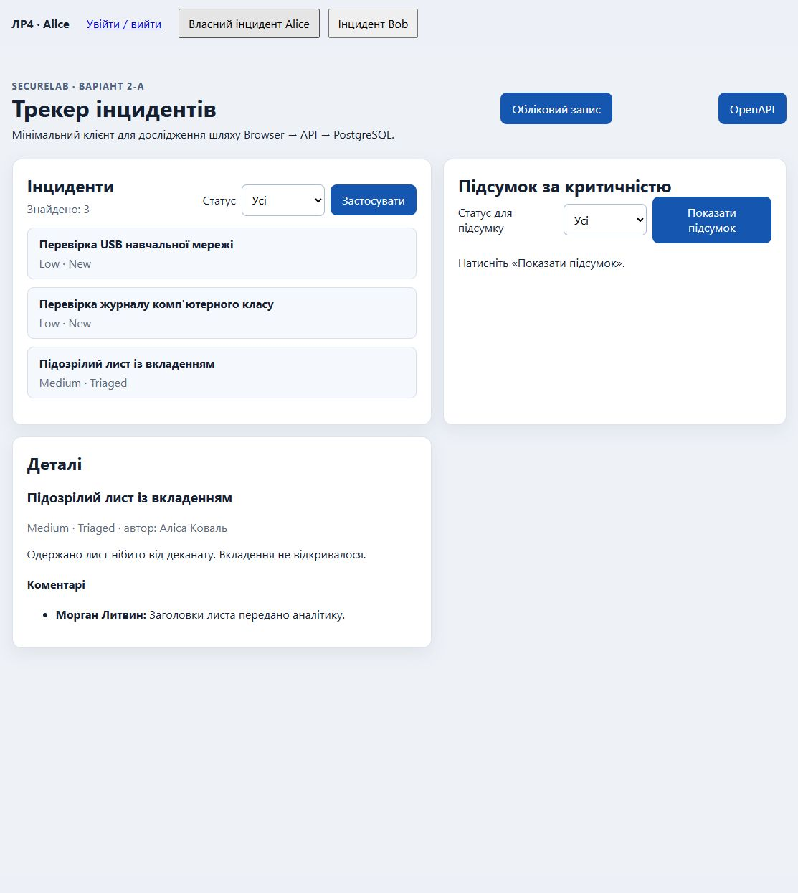
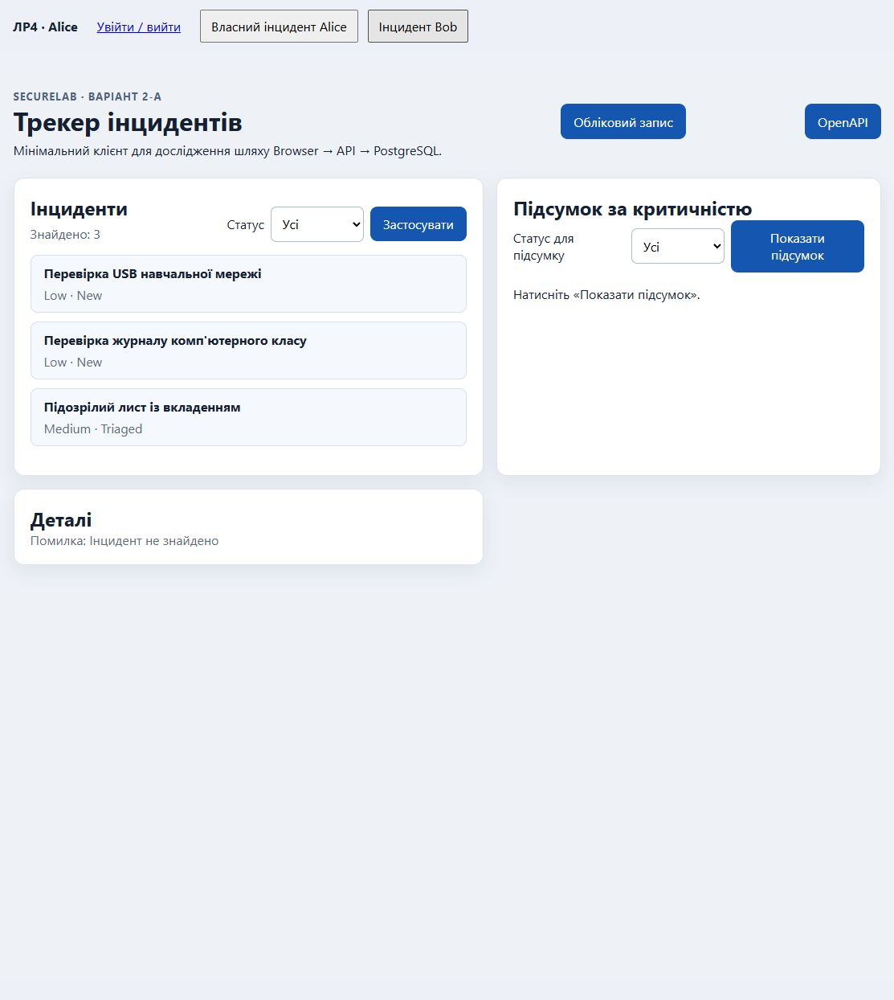

# Лабораторна робота №4. Авторизація та контроль доступу до ресурсів

Автор: Торонченко Дмитро, КБ-41. Дата: 20.10.2026.
Baseline 2-A «Трекер інцидентів». Обраний рівень — **«Добре»**: виконуються достатній і добрий рівні; A-11 та інші поглиблення «Відмінно» не заявляються.

## Контекст і межа виконання

- Робочий репозиторій: `lab-01-starter/starter-project`, а не зовнішня папка `lab-01-starter` з окремою історією Git.
- Private repository: `https://github.com/dimtor02/prykladne_prohramuvannya`.
- Гілка: `lab/4-authorization`.
- Base tag `v0.3.0`: `3390ea5ef3bb52f6d7758bc14f9fc39ff4c81ec0`.
- Vulnerable commit: `85ca4ac267633d128a9ac8dd9ca97242d1adc4d5`.
- Fixed commit і hash тегу `v0.4.0` записуються наступним документаційним commit після фактичної фінальної перевірки; див. розділ «Git і подання».
- Головна action — `GET /api/incidents/{id}`. Додатково охоплено list, PUT content, DELETE, triage та direct child read. Protected create успадкований із ЛР3.
- Додаткового виправлення ЛР3 після base tag не робилося; тег `v0.3.0` не пересувався.
- Тільки локальна PostgreSQL та синтетичні акаунти Alice/Bob/Morgan/admin; сторонні системи не тестувалися.

## Матриця і серверне рішення

Повна [матриця доступу](access-matrix.md) містить правила ролі, owner, context та статусів відмов.
Reporter читає лише власні інциденти, оновлює лише їх title/description і може їх видалити. Morgan/Analyst читає інциденти для аналізу, але не має права довільної зміни content чи видалення. Він виконує лише перехід New → Triaged. Administrator без Reporter/Analyst не отримує автоматичного обходу policy.

Правила централізовано в `Application/Incidents/IncidentAccessPolicy.cs`:

- `SubjectId` читає NameIdentifier з authenticated principal, `IsAnalyst` — перевірену роль; клієнтські X-Demo-UserId/X-Role/role не надають прав.
- `ScopeRead` обмежує list/details на рівні IQueryable до матеріалізації та використовується для перевірки parent у child endpoint.
- `Decide` перевіряє role + owner + context до mutation та SaveChanges.
- `IncidentAccessResults` однаково формує відмови для read/update/delete/triage/child.
- `UpdateIncidentRequest` містить лише title/description. Forged owner/role/status/severity/id/time ігноруються. Це контракт A-08a; A-08b не застосовується.
- Actor triage, server time і наступний статус задає сервер; body не визначає перехід.
- Details DTO не містить OwnerUserId або email. Internal comments відфільтровано з details Reporter, direct child перевіряє і parent, і IsInternal.

Політика: немає authentication → 401 без redirect; невидимий/невідомий ресурс → однаковий 404; ресурс видно, але дія заборонена → 403; дозволена роль з неправильним transition context → 409. Тому 403 для власного triage Reporter і 404 для чужого ресурсу узгоджені з різними передумовами матриці.

## Вразливий стан і локальний PoC

[Доказ до виправлення](evidence/lr04-vulnerable.md) створено для vulnerable commit. Початковий suite: 80 passed, 0 failed, 0 skipped; окремий PoC: 1 passed (успішне відтворення вразливості).

| Запит | За матрицею | До виправлення | Після виправлення |
|---|---|---|---|
| Alice GET власних details | allow | 200 | 200 |
| Alice GET Bob details із заміною id | deny | 200, розкрито чужі дані | 404 без чужих даних |
| Alice PUT Bob resource | deny, стан незмінний | 204, наступне читання Bob підтвердило зміну description | 404, стан Bob без змін |
| Reporter Alice POST triage Bob resource | deny, status незмінний | 204, New → Triaged підтверджено читанням БД | 404, стан без змін |
| Reporter Alice POST triage власного New | deny, status незмінний | Не заявляється як окремий старий PoC | 403, увесь стан без змін |

Authentication у PoC не вимикалася: справжній Identity login і cookie, Morgan `/api/me` → 200, anonymous `/api/me` → 401. Для мутацій Bob створював окремий synthetic incident, який видалявся в finally за точним id; seed не змінювався.

Причина горизонтального IDOR/BOLA: details шукали лише за id без зв'язку із subject. Причина mutation і вертикального bypass: RequireAuthorization доводила лише факт входу, після пошуку ресурсу зміна та SaveChanges відбувалися без owner/role/context decision. Forged role/status у body не були джерелом прав: дефект полягав у відсутності серверної перевірки.

## Виправлення та retest

Ті самі класи запитів повторено HTTP integration tests із реальним Identity login і PostgreSQL. Незмінність після deny перевіряється повторним читанням усіх scalar fields, comments і status history, а не лише HTTP-кодом. Позитивна регресія перевіряє власні details, regular update, owner delete і дозволений Analyst triage.

Повні [результати та безпечні HTTP-докази](evidence/lr04-test-results.md), [браузерний доказ](evidence/lr04-browser.md). Сирі TRX зберігаються локально поза Git у `tmp/lr04-tests`; дозволений вивід потрібних сценаріїв включено до evidence в репозиторії.

## Доказова таблиця

У колонці «Доказ» імена методів належать до `tests/SecureLab.Api.Tests/AuthorizationSecurityTests.cs`; їх фактичний вивід збережений у `evidence/lr04-test-results.md`.

| ID | Рівень | Сценарій | Передумови | Дія | Очікувано | Фактично | Доказ |
|---|---|---|---|---|---|---|---|
| A-01 | добрий | Anonymous | Без cookie | GET list/details/child, PUT/DELETE/triage | 401, без redirect | 401 Problem Details, Location відсутній; seed незмінний | `A01_AnonymousProtectedRequests_Return401WithoutRedirect` |
| A-02 | достатній | Власні details | Alice, власний incident-1 | GET details | 200 | 200; правильний id; немає ownerUserId/email | `A02_A03_A03R_DetailsFollowOwnerAndRoleMatrix` |
| A-03 | достатній | Чужі details | Alice, incident-2 Bob | GET, замінено лише id | 404 | 404; чужого description у відповіді немає | Той самий HTTP theory; A-10 |
| A-03R | достатній | Аналітичний read | Morgan/Analyst, incident-1 Alice | GET details | 200 без довільної mutation | 200; окремі PUT/DELETE Morgan → 403, стан незмінний | Details theory; `AnalystReadPermissionDoesNotGrantContentMutation` |
| A-04 | добрий | Чужі mutation | Alice, Bob resource | PUT/DELETE/triage | 404, стан незмінний | 404; scalar fields/comments/history збігаються до/після | `A04_NonOwnerMutation_Returns404_AndLeavesWholeResourceUnchanged` |
| A-05 | добрий | List | Login Alice/Bob/Morgan/admin | GET list | Дозволена множина | Alice — власні, Bob — власні, Morgan — всі, admin — порожній; перевірено точні id | `A05_ListContainsExactlyTheAllowedSet` |
| A-06 | добрий | Вертикальне підвищення | Reporter Alice, власний New | POST triage з forged role/status | 403, стан незмінний | 403 Forbidden; status/content/history незмінні | `A06_ReporterTriage_Returns403Forbidden_AndDoesNotChangeStatus` |
| A-07 | добрий | Дозволений transition | Morgan/Analyst, окремий New | POST triage; повторити | 204 New → Triaged; повтор 409 | 204; actor Morgan; forged Closed ігнорується; повтор 409 без змін | `A07_AnalystCanOnlyTriageNew_AndHistoryUsesVerifiedActor` |
| A-08a | добрий | Overposting: ignore | Alice, власний synthetic incident | PUT valid content + forged owner/role/status/severity/id/time | 204, protected state незмінний | Content змінено; owner/role/status/severity/id/created/occurred збережені; triage все ще 403 | `A08a_OwnerCanUpdateContent_ButForgedOwnerRoleStatusSeverityAreIgnored` |
| A-08b | альтернатива | Reject extra fields | Обрано A-08a | Не виконувалось | Не застосовується | Контракт ігнорує зайві поля | Матриця; A-08a |
| A-09 | добрий | Audit denied | Reporter, denied triage | Прочитати structured event | Без секретів, той самий trace | authorization.denied; subject/action/resource/result/UTC/trace; response trace збігається | `A09_DeniedPrivilegeAudit_ContainsOnlySafeFields_AndMatchingResponseTrace`; запис у evidence |
| A-10 | добрий, 404 | Чужий/невідомий id | Той самий Alice client | По два GET/PUT/DELETE/triage/child | Однакові status/Content-Type/body без correlation | 404; application/problem+json; JSON рівний після вилучення traceId/requestId | `A10_ForeignAndUnknownIds_HaveIdentical404Responses`; обидва тіла в evidence |
| A-11 | відмінний | Search і severity-summary | Не входить до обраного рівня | Не виконувалось | Не заявляється | Залишковий ризик задокументовано | Розділ finding; матриця |
| A-12 | добрий | Child та internal | Alice; Bob comment-2; Alice internal comment-3 | Direct child + details projection | Deny foreign/internal, internal відсутній у Reporter details | Public own 200; foreign/internal 404; internal відсутній у details; Morgan internal/foreign child/details 200 | `A12_ChildChecksParent_AndInternalCommentIsHiddenFromReporterOwner` |

## Основний finding і залишковий ризик

**Контекст:** authenticated Reporter працює з Incident. **Гіпотеза:** заміна identifier дозволяє перетнути межу власності, а будь-який login дає privileged transition. **Стан до:** vulnerable hash і HTTP-доказ наведені вище. **Причина:** authentication без resource authorization. **Fix:** централізована policy, query scoping, перевірка parent, вузький DTO та серверний transition. **Retest:** чужі read/mutations відхилено; стан після deny незмінний. **Позитивна регресія:** власні операції та дозволений Analyst read/triage працюють.

**Залишковий ризик:** search/severity-summary залишаються без subject scoping, тому поза перевіреним perimeter authenticated user може одержати чужі результати/агрегати. Це межа рівня «Добре», а не твердження про захист усього API. CSRF cookie mutations відкладено до ЛР6; SameSite=Lax не є повним CSRF-захистом. Concurrent transitions не захищено version check; окремого відтворюваного завдання викладача не надано. Batch/export не реалізовані.

## Browser flow

Виконано login Alice на `auth-lab.html`: login 204, profile 200; перехід на головну сторінку — три власні записи. Власні details показано без internal comment. Bob probe викликає `loadIncidentDetails("20000000-0000-0000-0000-000000000002")`; блок details замінено на «Помилка: Інцидент не знайдено».

У керованому браузері немає Console API, тому додано `lr04-probe.html`: дві кнопки викликають ту саму глобальну функцію незміненого клієнта в same-origin iframe. Це відтворюваний еквівалент Console-команди методички; він не надає прав і не підміняє HTTP-відповіді. Звичайний Console probe також лишається можливим у браузері студента.





`app.js` використовує textContent/createTextElement, не innerHTML. UI не приймає authorization-рішення. На знімках немає password/cookie/Set-Cookie чи вкладок Network/Application.

## Добрий рівень: роль, transition, child, audit

Morgan/Analyst потрібні одночасно роль і контекст New. Сервер задає Triaged і verified actor Morgan; повтор → 409 без history mutation. Reporter власного New → 403, чужого → 404. Direct child не обходить parent policy. Internal comment-3 прихований від власника-Reporter і доступний parent-authorized Analyst.

Audit denied triage містить тільки event, subject, action, resource, result, occurredAtUtc і traceId. Тест порівнює trace у Problem Details та structured log event, перевіряє точний набір полів і відсутність пароля, cookie, token, body. Безпечний фактичний запис збережено в evidence.

## Перевірки, відтворення і подання

Середовище: Windows, .NET 10, PostgreSQL 18.4 у локальному Docker, API `http://localhost:5080`. Точні версії й фінальні результати наведено в evidence.

Команди з кореня `starter-project`, у терміналі із локально заданим `SeedUsers__Password` поза Git:

```powershell
docker compose --env-file infra/.env.example -f infra/compose.yaml up -d --wait
dotnet build SecureLab.sln -c Release --no-restore -m:1 -nr:false -p:UseSharedCompilation=false
# API зупинено; ASPNETCORE_ENVIRONMENT=Development
dotnet run --project src/SecureLab.Api -c Release --no-build --no-restore -- --reset-database
dotnet test tests/SecureLab.Api.Tests/SecureLab.Api.Tests.csproj -c Release --no-build --no-restore
# Після tests, в окремому терміналі:
dotnet run --project src/SecureLab.Api -c Release --no-build --no-restore --launch-profile http
# В іншому терміналі:
python tests/http/lab-04-verify.py
```

Далі browser login → own details → Bob probe. Script `lab-04-verify.py` робить read/denied retest, не змінює seed; успішні mutation тести працюють з окремими fixtures і прибирають їх у finally.

Під час аудиту один sandbox run не з'єднав VSTest із testhost за 90 секунд. Повтор поза sandbox пройшов 113/113. Це інфраструктурна помилка; невдалий запуск не зараховано як успішний. Після останньої зміни виконано фінальний reset, Release build з 0 помилок/попереджень, **113 passed, 0 failed, 0 skipped** (33 authorization cases), live HTTP retest і повторний browser flow. Фінальний suite завершено 20.10.2026 о 21:47:13 +03:00; фактичний вивід збережено в evidence.

## Git і подання

Vulnerable і fixed states збережено різними commits; vulnerable містить реальний PoC і не є deployment state. `v0.4.0` ставиться лише на перевірений fixed commit. Повний fixed hash додається наступним commit зі звітом без amend і без пересування тегу. Статус передавання branch/tag у private remote та Moodle фіксується за фактом, а не припускається.

## Використання ШІ

Codex використано для аналізу методички, перевірки коду й HTTP-тестів, доповнення матриці/доказів, браузерного прогону та підготовки цього звіту. Зміни адаптовано до baseline Incident, verified Identity principal, реальної PostgreSQL, правила Reporter-owner/Analyst і обраної 404 policy. Тести виконано з login/cookie без mock authentication; порівняно стан БД після deny і фактичні browser states.

Ці інструментальні перевірки виконано за участю ШІ. Вони не видаються за самостійну ручну перевірку студентом. Перед захистом студент має сам повторити browser flow, пояснити policy/DTO/state assertions і Git diff. Окремий журнал ШІ за методичкою необов'язковий.
