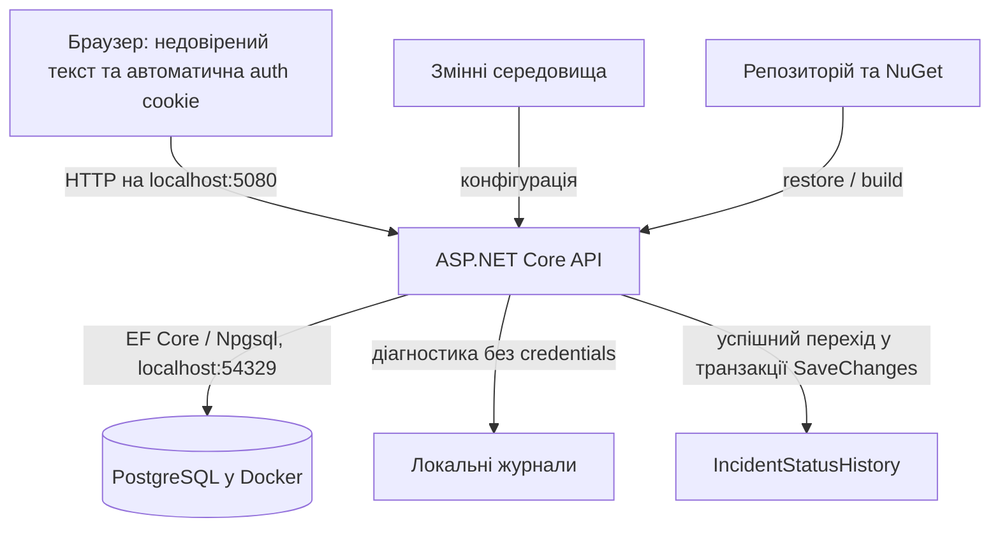

# Модель загроз SecureLab — ЛР6

Рівень: «Добре». Baseline 2-A. Дата: 04.11.2026. Початок огляду: `e8b62cf0665bbff5a6247a53db5751663a9c2e84` (`v0.5.0`).

## Система та межі

Фактичний клієнт: три сторінки `/`, `/auth-lab.html`, `/browser-lab.html`; `/lr04-probe.html` — успадкована локальна перевірка в iframe. Redis, reverse proxy та зовнішній deployment відсутні. Development використовує локальний HTTP. TestServer з `https://localhost` перевіряє поведінку cookie, а не шифрування мережі.

## Активи, суб’єкти й перевірки

| Актив / суб’єкт | Загроза | Контроль | Перевірка |
|---|---|---|---|
| Cookie-сеанс Alice/Bob, право змінювати власний Incident | Автоматичне надсилання cookie без підтвердження наміру | Standard antiforgery, однаковий filter на 5 mutations | REG-CSRF-01; 10 perimeter cases; browser-csrf.json |
| Вміст Incident і коментарів | SQLi та виконання введеного HTML | Параметри SQL, allowlist сортування, textContent | S-02, T-04/T-05; REG-XSS-01 |
| Чужі записи та внутрішні коментарі | IDOR/BOLA через відомий Guid | IncidentAccessPolicy, ScopeRead, parent authorization | A-02–A-12 у AuthorizationSecurityTests |
| Привілейований перехід статусу | Reporter видає себе за Analyst | Роль із cookie principal; серверний New → Triaged | A-06/A-07; runtime audit: deny незмінний, Morgan success |
| Credentials, конфігурація | Витік із репозиторію, логів або HTTP 500 | Environment password, safe ProblemDetails, без raw body у логах | Secret-match review; S-01; runtime-checks.json |
| Доступність пошуку та входу | Вичерпання ресурсів повторними запитами | Login quota; search quota за principal / transport IP | LoginRateLimit_*; REG_RATE_SEARCH_* |
| Цілісність збірки | Відома вразлива залежність або непомітна зміна графа | Lockfiles, locked restore, NuGet direct/transitive audit | baseline-restore.txt, dependency-audit.txt |

Анонімний користувач має доступ до login/register, health і успадкованих public search/summary. Reporter читає та змінює власні записи; Analyst читає доступні йому записи та виконує triage. Administrator не отримує права Analyst автоматично. Рішення про роль, owner, status не приймаються з client headers/body.

## Кожна межа довіри → очікувана властивість → конкретний доказ

| Межа | Властивість | Доказ |
|---|---|---|
| Browser → API | Mutation потребує справжньої сесії та валідної token/cookie пари; обхід UI не обходить перевірку | HardeningSecurityTests.REG_CSRF_Perimeter_*; REG_CSRF_01_*; browser-csrf.json |
| API → browser DOM | Недовірений текст лишається текстом; помилки не віддають внутрішні деталі | browser-lr05/fixed.json; runtime 500 з обмеженим JSON |
| API → PostgreSQL | Пошуковий текст не змінює SQL; owner/status визначаються сервером | IncidentSearchTests.S02_*; IncidentCreationTests.T01_*; AuthorizationSecurityTests.A07_* |
| Environment → configuration | Production не читає Development config, reset заборонено, teaching CORS відсутній | Production_HeadersOnFiveResponseKinds_AndResetForbidden; Production_DoesNotRegisterOrApplyTeachingCorsPolicy |
| Repository/package sources → build | Поточні tracked файли перевірені, locked restore відтворює graph, відомі advisories оцінені | secret-match-review.md; baseline-restore.txt; dependency-audit.txt |
| API → logs/audit | Подія має subject/action/resource/result/time, credentials не потрапляють до sink | A09_DeniedPrivilegeAudit_*; runtime-checks.json → logReview/audit |

## Виключення й залишкові ризики

- Лише власний loopback-стенд і штучні облікові записи. Зовнішні системи, production TLS/HSTS, інші клони, CI та повна історія Git не перевірялися.
- Public search і severity summary успадковані; їхня модель видимості не прирівнюється до scoped detail/list. Потребують окремого рішення перед deployment.
- Login-CSRF/account creation не покриті authenticated token endpoint. Це явне виключення; для повного захисту потрібний окремий anonymous bootstrap, а не вимога отримати post-login token до входу.
- In-memory quotas не спільні між інстансами. NAT об’єднує анонімних користувачів в один IP partition.
- Concurrency triage/унікальність активної назви під конкурентним навантаженням не перевірялися цією роботою.
- Повний ризик-реєстр, відповідальні та наступні дії — у [security review](report-lr06.md#10-residual-risks).
